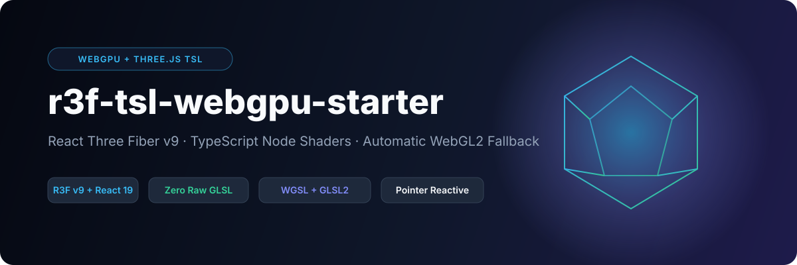
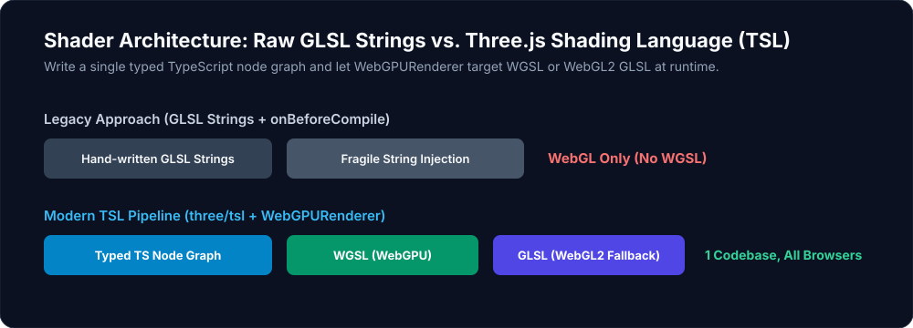
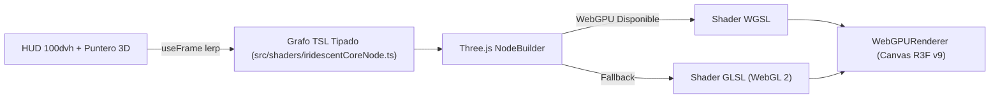

<p align="right">
  <a href="./README.md">🇺🇸 Read in English</a>
</p>

<p align="center">
  
</p>

<p align="center">
  
  
  
  
</p>

# R3F v9 + Three.js TSL WebGPU Starter

Plantilla 3D interactiva que combina **React 19**, **React Three Fiber v9**, **Three.js `WebGPURenderer`** y **TSL (Three.js Shading Language)**. Escribe desplazamiento procedural de vértices e iridiscencia Fresnel en TypeScript puro y deja que Three.js compile automáticamente el mismo grafo de nodos a **WGSL** en navegadores con WebGPU o a **GLSL** en WebGL 2.

---

## Por qué importa TSL + WebGPURenderer

Lanzar experiencias WebGPU en producción tiene un reto clásico: no todos los navegadores soportan WebGPU todavía, y mantener dos bases de código de shaders (WGSL y GLSL) es inviable. **TSL** resuelve esto de raíz permitiéndote construir grafos de nodos tipados que se transpilan al backend que `WebGPURenderer` detecte en tiempo de ejecución.

<p align="center">
  
</p>

---

## Flujo de Nodos y Renderizado



---

## Características principales

- **Cero strings de shader (`src/shaders/iridescentCoreNode.ts`)**: Usa `MeshStandardNodeMaterial` de `three/webgpu` y nodos tipados (`positionLocal`, `normalLocal`, `sin`, `time`, `uniform`) de `three/tsl` para deformación armónica y brillo Fresnel.
- **`WebGPURenderer` asíncrono + Fallback (`src/components/SceneCanvas.tsx`)**: Inicializa `WebGPURenderer` dentro del prop `gl` de R3F v9, detecta `isWebGPUBackend` y muestra el backend activo en vivo en el HUD.
- **Ondas reactivas al puntero 3D (`src/components/ReactiveCoreMesh.tsx`)**: Convierte las intersecciones del raycast a espacio local e interpola `uPointer` en `useFrame`, liberando explícitamente recursos GPU con `material.dispose()`.
- **Controles en pantalla completa `100dvh` (`src/App.tsx`)**: Sliders en tiempo real para frecuencia armónica, amplitud de desplazamiento y paletas de color.

---

## Inicio rápido

```bash
git clone https://github.com/stephanocamoretti-dotcom/r3f-tsl-webgpu-starter.git
cd r3f-tsl-webgpu-starter
npm install
npm run dev
```

---

## Ideas de escalado para producción

1. **Partículas con Compute Shaders en WebGPU**: Añade pases `compute()` en TSL con buffers de almacenamiento para 100k+ partículas en WebGPU, manteniendo una ruta ligera con `InstancedMesh` para el fallback WebGL 2.
2. **Configuradores 3D para E-commerce**: Reemplaza el icosaedro por modelos `.glb` comprimidos (Draco + KTX2) y conecta los `uniform()` del material al estado de React o a comandos de voz con IA.
3. **Integración en Next.js App Router**: Envuelve `<SceneCanvas>` en un Client Component (`'use client'`) con `dynamic(..., { ssr: false })` para cargar la escena 3D solo cuando entra en el viewport.
4. **Cadenas de Post-Procesamiento TSL**: Extiende `WebGPURenderer` con `PostProcessing` nativo en TSL (bloom, aberración cromática, profundidad de campo) sin librerías externas pesadas.

---

## Referencias

- [Guía de migración a React Three Fiber v9 — Poimandres](https://r3f.docs.pmnd.rs/tutorials/v9-migration-guide)
- [API de Canvas en R3F y control del renderer](https://r3f.docs.pmnd.rs/api/canvas)
- [Wiki oficial de Three.js Shading Language (TSL)](https://github.com/mrdoob/three.js/wiki/Three.js-Shading-Language)
- [TSL Explained: Three.js Shading Language en la práctica](https://threejsresources.com/tsl)
- [Field Guide to TSL and WebGPU — Maxime Heckel](https://blog.maximeheckel.com/posts/field-guide-to-tsl-and-webgpu/)
