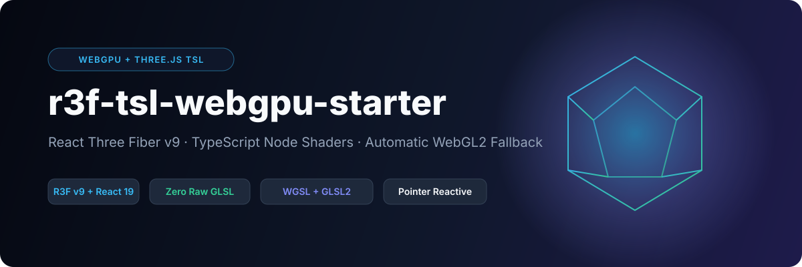
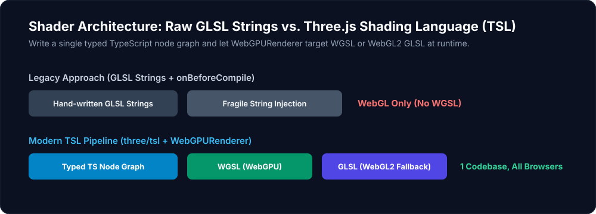
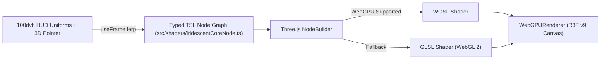

<p align="right">
  <a href="./README.es.md">🇪🇸 Leer en Español</a>
</p>

<p align="center">
  
</p>

<p align="center">
  
  
  
  
</p>

# R3F v9 + Three.js TSL WebGPU Starter

A clean, interactive 3D starter combining **React 19**, **React Three Fiber v9**, **Three.js `WebGPURenderer`**, and **TSL (Three.js Shading Language)**. Write procedural vertex displacement and Fresnel iridescence in pure, composable TypeScript—and let Three.js compile the exact same node graph to **WGSL** on WebGPU browsers or **GLSL** on WebGL 2 browsers automatically.

---

## Why TSL + WebGPURenderer Matters

Shipping WebGPU commercially has a classic adoption catch: not every visitor's browser supports WebGPU yet, and maintaining parallel WGSL and GLSL shader codebases is unsustainable. **TSL (Three.js Shading Language)** solves this structurally by letting you author node graphs in JavaScript/TypeScript that transpile to whichever backend `WebGPURenderer` initializes at runtime.

<p align="center">
  
</p>

---

## Node Graph & Runtime Flow



---

## Key Features

- **Zero Raw Shader Strings (`src/shaders/iridescentCoreNode.ts`)**: Uses `MeshStandardNodeMaterial` from `three/webgpu` and typed nodes (`positionLocal`, `normalLocal`, `sin`, `time`, `uniform`) from `three/tsl` for harmonic vertex displacement and Fresnel rim glow.
- **Async `WebGPURenderer` + Fallback (`src/components/SceneCanvas.tsx`)**: Initializes `WebGPURenderer` inside R3F v9's `gl` factory prop, detects `isWebGPUBackend`, and reports the active GPU backend live in the HUD.
- **Pointer-Reactive 3D Ripple (`src/components/ReactiveCoreMesh.tsx`)**: Converts 3D raycast hits into object space and smoothly interpolates `uPointer` inside `useFrame`, with explicit `material.dispose()` cleanup on unmount.
- **Full-Viewport `100dvh` Controls (`src/App.tsx`)**: Real-time sliders for harmonic frequency, displacement amplitude, and color presets.

---

## Quick Start

```bash
git clone https://github.com/stephanocamoretti-dotcom/r3f-tsl-webgpu-starter.git
cd r3f-tsl-webgpu-starter
npm install
npm run dev
```

---

## Scaling Ideas for Production

1. **WebGPU Compute Particle Fields**: Add TSL `compute()` storage-buffer passes for 100k+ GPU particles on WebGPU visitors while serving a lightweight `InstancedMesh` path for WebGL 2 fallback.
2. **Interactive E-Commerce Product Configurators**: Swap the icosahedron for compressed `.glb` (Draco + KTX2) product meshes and drive finish/material uniforms from React state or AI voice commands.
3. **Next.js App Router Integration**: Wrap `<SceneCanvas>` in a Client Component (`'use client'`) with `dynamic(..., { ssr: false })` and lazy-load heavy 3D routes only when scrolled into view.
4. **Post-Processing Node Chains**: Extend `WebGPURenderer` with TSL `PostProcessing` (bloom, chromatic aberration, depth of field) without extra third-party effect composer overhead.

---

## References

- [React Three Fiber v9 Migration Guide — Poimandres](https://r3f.docs.pmnd.rs/tutorials/v9-migration-guide)
- [React Three Fiber Canvas API & Custom Renderer Ownership](https://r3f.docs.pmnd.rs/api/canvas)
- [Three.js Shading Language (TSL) Official Wiki](https://github.com/mrdoob/three.js/wiki/Three.js-Shading-Language)
- [TSL Explained: The Three.js Shading Language in Practice](https://threejsresources.com/tsl)
- [Field Guide to TSL and WebGPU — Maxime Heckel](https://blog.maximeheckel.com/posts/field-guide-to-tsl-and-webgpu/)
